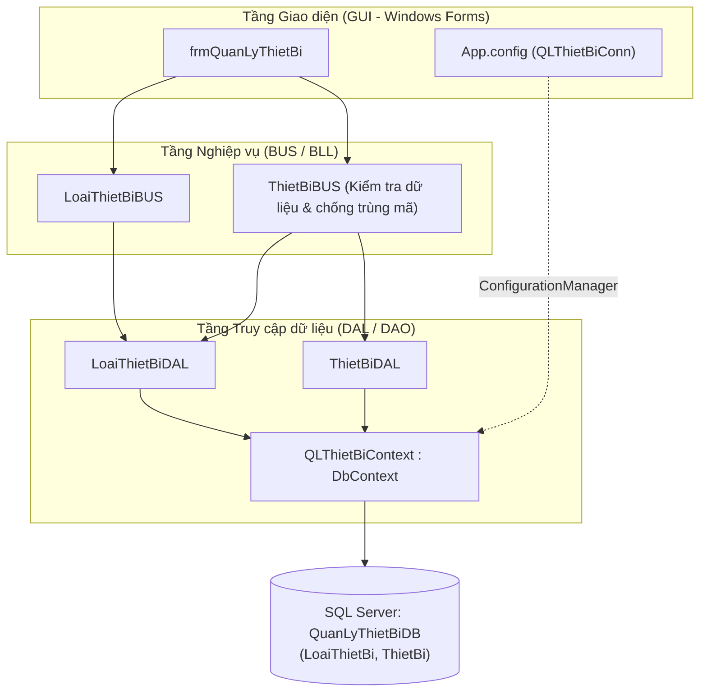

# BÀI THI GIỮA KỲ (MÃ ĐỀ 03): QUẢN LÝ THIẾT BỊ PHÒNG HỌC

**Môn học:** Lập trình nâng cao C# (LTNC)  
**Sinh viên thực hiện:** Phạm Văn Quang  
**Mã số sinh viên (MSSV):** 23110342  
**Đơn vị:** Đại học Quốc gia Hà Nội - Trường Đại học Việt Nhật (VJU)  
**Ngày thực hiện:** 07/11/2026  
**Kho lưu trữ (GitHub):** [https://github.com/QUANGPV021/23110342_PhamVanQuang_LTNC/tree/main/BTTH_GK](https://github.com/QUANGPV021/23110342_PhamVanQuang_LTNC/tree/main/BTTH_GK)

---

## 1. Yêu cầu đề bài (Mã đề 03)

Xây dựng ứng dụng **Windows Forms Quản lý thiết bị phòng học** sử dụng **Entity Framework Core (Code First + Migrations)**, **SQL Server** và mô hình **Three-Layer (`GUI` → `BUS` → `DAL`)**:

1. **Mô hình dữ liệu & EF Core Code First (3,0 điểm):**
   - `LoaiThietBi`: `MaLoai` (`string(10)`, khóa chính), `TenLoai` (`string(100)`, bắt buộc).
   - `ThietBi`: `MaTB` (`string(20)`, khóa chính), `TenTB` (`string(150)`, bắt buộc), `NgayMua` (`DateTime`), `SoLuong` (`int`), `DonGia` (`decimal(18,2)`), `MaLoai` (`string(10)`, khóa ngoại bắt buộc).
   - Cấu hình bằng **Data Annotations**, khai báo đầy đủ navigation properties 2 chiều (`1 - N`), đọc chuỗi kết nối từ tệp `App.config` và tạo CSDL bằng **Migration**.
2. **Tổ chức mô hình Three-Layer (2,0 điểm):**
   - Tách 3 project độc lập: `GUI` (Windows Forms), `BUS` (xử lý quy tắc nghiệp vụ) và `DAL` (truy cập CSDL bằng EF Core).
   - Luồng xử lý: `GUI` → `BUS` → `DAL` → CSDL (`GUI` không khởi tạo `DbContext` hoặc gọi `DbSet`/`SaveChanges`; `DAL` không tham chiếu WinForms).
3. **Thiết kế giao diện (2,0 điểm):**
   - Tiêu đề Form: `Quản lý thiết bị – 23110342 – Phạm Văn Quang`, hiển thị giữa màn hình (`CenterScreen`).
   - Thứ tự `TabIndex` hợp lý; `Enter` thực hiện nút **Nhập**; `Esc` thực hiện nút **Thoát**.
   - Khi Form Load hoặc nhấn **Mới**: xóa trắng ô nhập, bỏ chọn dòng trên bảng, `ComboBox` ở trạng thái chưa chọn, đưa con trỏ về `txtMaTB`, bật **Nhập**, tắt **Sửa/Xóa**. Khi chọn dòng hợp lệ: khóa sửa mã (`txtMaTB`), tắt **Nhập**, bật **Sửa/Xóa**.
4. **Chức năng & Kiểm tra dữ liệu (3,0 điểm):**
   - Nạp danh sách loại thiết bị vào `cboLoaiThietBi` và thiết bị (hiển thị tên loại) vào `dgvThietBi`.
   - Thêm, sửa (giữ nguyên khóa chính), xóa thiết bị lưu bền vững vào SQL Server.
   - Kiểm tra nghiệp vụ tại `BUS`: không để trống mã/tên, bắt buộc chọn loại thiết bị, `NgayMua <= DateTime.Today`, `SoLuong > 0`, `DonGia > 0`, chống trùng mã sau khi `.Trim()`.
   - Xác nhận trước khi xóa; xác nhận thoát tập trung một nơi duy nhất (nút **Thoát**, nút **X**, phím **Esc** không bị hiển thị lặp 2 hộp thoại).

---

## 2. Cấu trúc thư mục `BTTH_GK`

```text
BTTH_GK/
├── .gitignore                                       # Bỏ qua bin/, obj/, .vs/
├── QuanLyThietBi.sln                                # File Solution Visual Studio 2022
├── README.md                                        # Tài liệu mô tả và hướng dẫn chạy
│
├── DAL/                                             # Tầng Truy cập dữ liệu (Data Access Layer)
│   ├── DAL.csproj
│   ├── Entities/
│   │   ├── LoaiThietBi.cs                           # Entity Loại thiết bị (Data Annotations)
│   │   └── ThietBi.cs                               # Entity Thiết bị (Data Annotations, decimal(18,2), FK)
│   ├── Migrations/                                  # EF Core Code First Migrations + Seed Data
│   │   ├── 20261107080328_InitDatabase.cs
│   │   ├── 20261107080328_InitDatabase.Designer.cs
│   │   └── QLThietBiContextModelSnapshot.cs
│   ├── QLThietBiContext.cs                          # DbContext đọc chuỗi kết nối từ App.config
│   ├── LoaiThietBiDAL.cs                            # Truy vấn bảng LoaiThietBi
│   └── ThietBiDAL.cs                                # Truy vấn (Include), Thêm, Sửa, Xóa bảng ThietBi
│
├── BUS/                                             # Tầng Nghiệp vụ (Business Logic Layer)
│   ├── BUS.csproj
│   ├── OperationResult.cs                           # Đóng gói kết quả & thông báo lỗi nghiệp vụ
│   ├── LoaiThietBiBUS.cs                            # Nghiệp vụ loại thiết bị
│   └── ThietBiBUS.cs                                # Kiểm tra hợp lệ dữ liệu & mã trùng trước khi lưu
│
└── GUI/                                             # Tầng Giao diện (Presentation Layer - WinForms)
    ├── GUI.csproj
    ├── App.config                                   # Lưu chuỗi kết nối SQL Server (QLThietBiConn)
    ├── Program.cs                                   # Điểm khởi chạy ứng dụng
    ├── frmQuanLyThietBi.cs                          # Xử lý sự kiện giao diện, Enter/Esc, xác nhận Xóa/Thoát
    └── frmQuanLyThietBi.Designer.cs                 # Thiết kế giao diện Form & DataGridView 6 cột
```

---

## 3. Sơ đồ kiến trúc Three-Layer



---

## 4. Hướng dẫn chạy chương trình trên Visual Studio 2022

1. Mở tệp **`QuanLyThietBi.sln`** bằng **Visual Studio 2022**.
2. Kiểm tra chuỗi kết nối SQL Server trong tệp `GUI/App.config` (`QLThietBiConn`):
   - Mặc định đang cấu hình `Server=(localdb)\MSSQLLocalDB;Database=QuanLyThietBiDB;Trusted_Connection=True;TrustServerCertificate=True;` (chạy ngay trên mọi máy cài sẵn Visual Studio 2022).
   - Nếu dùng SQL Server Express hoặc instance riêng trên máy (ví dụ `.\SQLEXPRESS`), chỉ cần thay giá trị `Server=...` tương ứng trong `GUI/App.config`.
3. Chuột phải vào project **`GUI`** → chọn **Set as Startup Project**.
4. Nhấn **`F5`** để biên dịch và khởi chạy:
   - Trong lần chạy đầu tiên, ứng dụng tự động thực thi Migration (`Database.Migrate()`) để tạo CSDL `QuanLyThietBiDB` cùng 4 loại thiết bị và 5 thiết bị mẫu.
   - Hoặc có thể mở **Tools → NuGet Package Manager → Package Manager Console**, chọn *Default project* là `DAL` và chạy lệnh:
     ```powershell
     Update-Database
     ```
