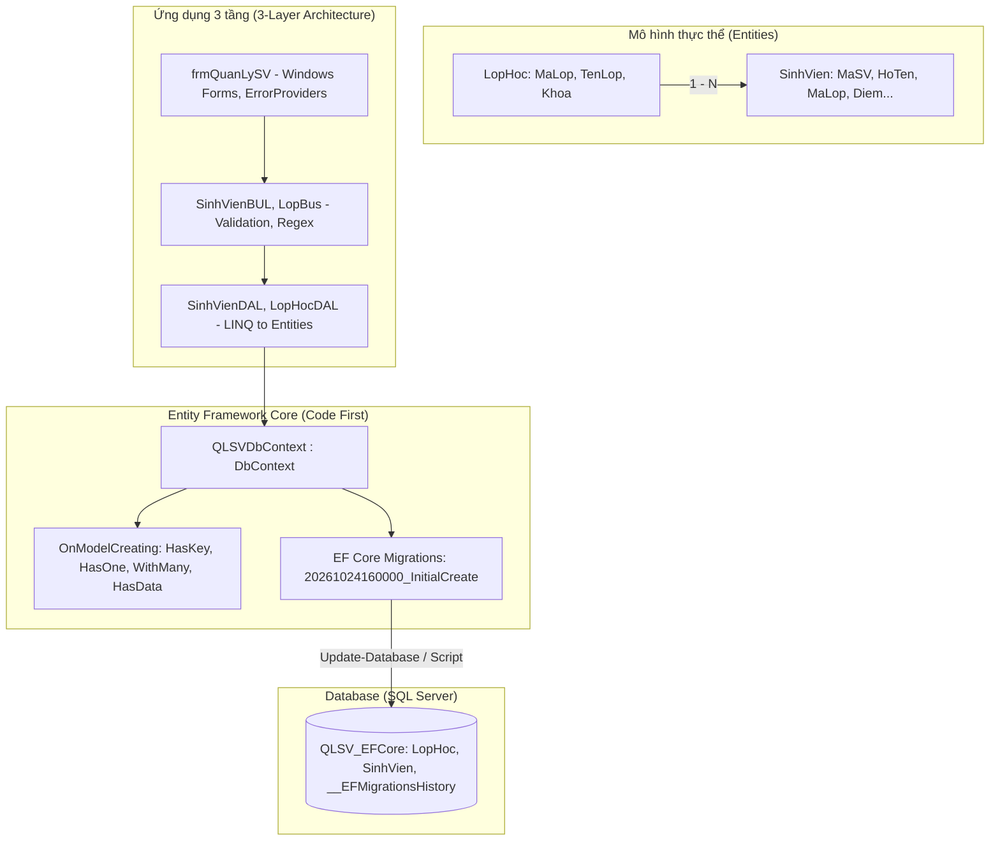

# BÀI THỰC HÀNH BUỔI 6: ENTITY FRAMEWORK CORE CODE FIRST & MIGRATIONS

**Môn học:** Lập trình nâng cao (LTNC)  
**Sinh viên thực hiện:** Phạm Văn Quang  
**Mã số sinh viên (MSSV):** 23110342  
**Đơn vị:** Đại học Quốc gia Hà Nội - Trường Đại học Việt Nhật (VJU)  
**Tài liệu tham khảo:** [EF Core Migrations Tutorial](https://www.entityframeworktutorial.net/efcore/entity-framework-core-migration.aspx)  
**Kho lưu trữ (GitHub):** [https://github.com/QUANGPV021/23110342_PhamVanQuang_LTNC/tree/main/buoi6](https://github.com/QUANGPV021/23110342_PhamVanQuang_LTNC/tree/main/buoi6)

---

## 1. Yêu cầu đề bài

Dựa theo bài hướng dẫn [Entity Framework Core Migration Tutorial](https://www.entityframeworktutorial.net/efcore/entity-framework-core-migration.aspx), bài thực hành yêu cầu:
1. **Xây dựng mô hình thực thể (Entities Model) với ít nhất 2 lớp:**
   - Lớp `LopHoc` (Lớp học) và `SinhVien` (Sinh viên) có quan hệ **1 - N** (Một lớp học có nhiều sinh viên; mỗi sinh viên thuộc về một lớp).
   - Sử dụng các Data Annotations (`[Key]`, `[Required]`, `[StringLength]`, `[ForeignKey]`, `[Table]`, `[Column]`,...) và phương thức kiểm tra hợp lệ `IsInValid()`.
2. **Áp dụng Entity Framework Core theo phương pháp Code First:**
   - Xây dựng lớp ngữ cảnh dữ liệu `QLSVDbContext` kế thừa `DbContext`.
   - Khai báo các tập hợp `DbSet<LopHoc>` và `DbSet<SinhVien>`.
   - Cấu hình quan hệ và quy tắc ánh xạ bằng **Fluent API** trong `OnModelCreating`.
   - Nạp dữ liệu ban đầu (**Seed Data**) bằng `HasData()` theo chuẩn EF Core.
3. **Quản lý lược đồ CSDL bằng EF Core Migrations:**
   - Tạo Migration ban đầu `InitialCreate` bao gồm các phương thức `Up()` (tạo bảng, khóa, quan hệ, nạp dữ liệu mẫu) và `Down()` (xóa bảng khi revert).
   - Lưu trữ ảnh chụp mô hình hiện tại trong `QLSVDbContextModelSnapshot.cs`.
4. **Nâng cấp tầng DAL và Business sang EF Core:**
   - Tầng DAL thực hiện các thao tác CRUD và truy vấn LINQ to Entities (sử dụng Eager Loading với `.Include(s => s.LopHoc)`).
   - Tầng Business (BUL) kiểm tra tính hợp lệ, chuẩn hóa dữ liệu bằng `Regex(@"\s+")`, và ném ngoại lệ lên tầng View.
   - Tầng View (`frmQuanLySV`) bao bọc toàn bộ sự kiện trong khối `try ... catch` để xử lý ngoại lệ an toàn.
5. **Commit lên GitHub với comment:**
   - `Entity framework core code first ngày 24/10/2026`

---

## 2. Cấu trúc thư mục `buoi6`

```text
buoi6/
├── .gitignore                               # Bỏ qua bin/, obj/, .vs/
├── code.slnx                                # File Solution XML thế hệ mới
├── QuanLySinhVien.sln                       # Solution tiêu chuẩn Visual Studio 2022
├── QLSV_EFCore.sql                          # Script SQL tương đương tạo CSDL từ Migrations
├── README.md                                # Báo cáo chi tiết và tài liệu hướng dẫn
│
├── QuanLySinhVien/                          # Dự án Windows Forms (EF Core Code First)
│   ├── QuanLySinhVien.csproj                # Đã cài đặt các gói NuGet EF Core 8.0.10
│   ├── Program.cs                           # Entry point của ứng dụng WinForms
│   ├── Data/
│   │   ├── Entity/
│   │   │   ├── LopHoc.cs                    # Thực thể LopHoc (Principal Entity, Quan hệ 1 - N)
│   │   │   └── SinhVien.cs                  # Thực thể SinhVien (Dependent Entity, Khóa ngoại MaLop)
│   │   ├── Context/
│   │   │   └── QLSVDbContext.cs             # Lớp DbContext cấu hình Code First & Fluent API
│   │   ├── Migrations/                      # Thư mục Migrations theo chuẩn EF Core
│   │   │   ├── 20261024160000_InitialCreate.cs
│   │   │   ├── 20261024160000_InitialCreate.Designer.cs
│   │   │   └── QLSVDbContextModelSnapshot.cs
│   │   └── DAL/
│   │       ├── SinhVienDAL.cs               # Data Access: CRUD qua EF Core DbContext (alias SinhVienDAO)
│   │       └── LopHocDAL.cs                 # Data Access: Quản lý danh sách lớp bằng EF Core (alias LopHocDAO)
│   ├── BUL/
│   │   ├── SinhVienBUL.cs                   # Business: Validation, chuẩn hóa Regex, gọi EF Core
│   │   └── LopBus.cs                        # Business: Nghiệp vụ quản lý lớp học
│   └── Views/
│       ├── frmQuanLySV.cs                   # Tầng View: Bắt ngoại lệ try-catch, ErrorProviders
│       └── frmQuanLySV.Designer.cs          # Giao diện WinForms hiện đại
│
└── QuanLySinhVien.ConsoleApp/               # Dự án Console kiểm thử tự động
    ├── QuanLySinhVien.ConsoleApp.csproj     # Đã cấu hình các gói EF Core
    └── Program.cs                           # Kịch bản kiểm thử mô hình Code First, LINQ, Validation
```

---

## 3. Chi tiết triển khai EF Core Code First



### 3.1. Các gói NuGet (Packages) sử dụng
Dự án được tích hợp các thư viện EF Core chính thức từ Microsoft:
- `Microsoft.EntityFrameworkCore` (v8.0.10): Core engine của Entity Framework Core.
- `Microsoft.EntityFrameworkCore.SqlServer` (v8.0.10): Provider kết nối với Microsoft SQL Server.
- `Microsoft.EntityFrameworkCore.Tools` (v8.0.10): Cung cấp các lệnh PMC như `Add-Migration`, `Update-Database`.
- `Microsoft.EntityFrameworkCore.Design` (v8.0.10): Hỗ trợ công cụ tạo mã Migrations lúc thiết kế.

### 3.2. Cấu hình Fluent API & Seed Data trong `QLSVDbContext`
```csharp
protected override void OnModelCreating(ModelBuilder modelBuilder)
{
    base.OnModelCreating(modelBuilder);

    // Cấu hình bảng LopHoc
    modelBuilder.Entity<LopHoc>(entity =>
    {
        entity.ToTable("LopHoc");
        entity.HasKey(e => e.MaLop);
        entity.Property(e => e.MaLop).HasMaxLength(20).IsRequired();
        entity.Property(e => e.TenLop).HasMaxLength(100).IsRequired();
    });

    // Cấu hình bảng SinhVien và quan hệ 1 - N
    modelBuilder.Entity<SinhVien>(entity =>
    {
        entity.ToTable("SinhVien");
        entity.HasKey(e => e.MaSV);
        entity.Property(e => e.MaSV).HasMaxLength(20).IsRequired();
        entity.Property(e => e.HoTen).HasMaxLength(100).IsRequired();

        entity.HasOne(s => s.LopHoc)
              .WithMany(l => l.DanhSachSinhVien)
              .HasForeignKey(s => s.MaLop)
              .OnDelete(DeleteBehavior.Cascade)
              .HasConstraintName("FK_SinhVien_LopHoc");
    });

    // Nạp dữ liệu mẫu ban đầu (Seed Data)
    modelBuilder.Entity<LopHoc>().HasData(...);
    modelBuilder.Entity<SinhVien>().HasData(...);
}
```

### 3.3. Các lệnh Migration đã sử dụng
Theo hướng dẫn của bài học:
1. **Tạo Migration ban đầu:**
   - Package Manager Console (Visual Studio): `Add-Migration InitialCreate`
   - .NET Core CLI: `dotnet ef migrations add InitialCreate`
2. **Cập nhật lược đồ vào CSDL:**
   - Package Manager Console: `Update-Database -Verbose`
   - .NET Core CLI: `dotnet ef database update`
3. **Xuất script SQL từ Migration:**
   - Package Manager Console: `Script-Migration`
   - .NET Core CLI: `dotnet ef migrations script` -> Được lưu thành file [QLSV_EFCore.sql](file:///Users/phamquang/Projects/ltnc/buoi6/QLSV_EFCore.sql).

---

## 4. Hướng dẫn chạy chương trình

### Cách 1: Chạy qua Visual Studio 2022
1. Mở file `QuanLySinhVien.sln` hoặc `code.slnx`.
2. Mở cửa sổ **Package Manager Console** (`Tools -> NuGet Package Manager -> Package Manager Console`).
3. Gõ lệnh:
   ```powershell
   Update-Database
   ```
   EF Core sẽ tự động kết nối SQL Server, tạo CSDL `QLSV_EFCore`, tạo bảng và nạp sẵn dữ liệu mẫu.
4. Đặt `QuanLySinhVien` làm Startup Project và nhấn **F5** để khởi chạy giao diện WinForms.

### Cách 2: Chạy trực tiếp script SQL
1. Mở **SQL Server Management Studio (SSMS)**.
2. Mở file [QLSV_EFCore.sql](file:///Users/phamquang/Projects/ltnc/buoi6/QLSV_EFCore.sql) và nhấn **Execute (F5)**.
3. Chạy ứng dụng WinForms hoặc ConsoleApp để kiểm thử.
