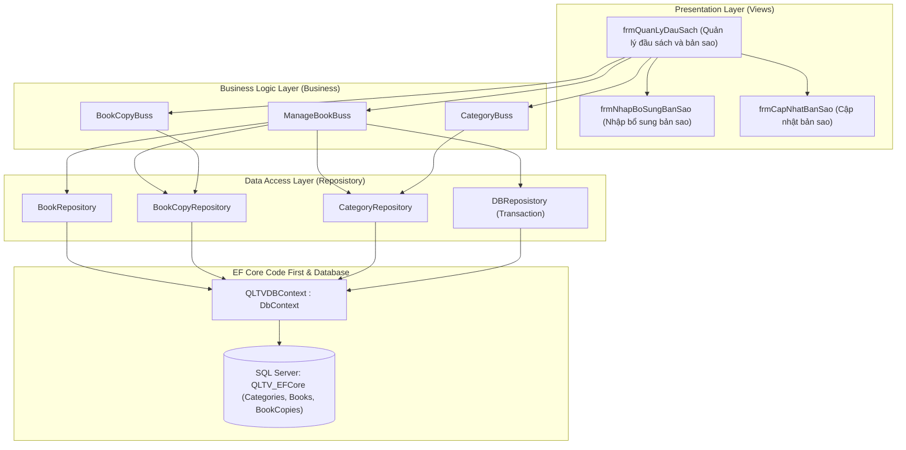

# BÀI THỰC HÀNH BUỔI 7: QUẢN LÝ ĐẦU SÁCH VÀ BẢN SAO (EF CORE & KIẾN TRÚC ĐA TẦNG)

**Môn học:** Lập trình nâng cao (LTNC)  
**Sinh viên thực hiện:** Phạm Văn Quang  
**Mã số sinh viên (MSSV):** 23110342  
**Đơn vị:** Đại học Quốc gia Hà Nội - Trường Đại học Việt Nhật (VJU)  
**Ngày thực hiện:** 31/10/2026  
**Kho lưu trữ (GitHub):** [https://github.com/QUANGPV021/23110342_PhamVanQuang_LTNC/tree/main/buoi7](https://github.com/QUANGPV021/23110342_PhamVanQuang_LTNC/tree/main/buoi7)

---

## 1. Yêu cầu bài tập

Xây dựng ứng dụng **Quản lý đầu sách và bản sao** theo kiến trúc phân tầng với **Entity Framework Core (Code First)**:
1. **Tầng Thực thể (`Entity`):**
   - `Category` (Thể loại sách) — quan hệ `1 - N` với `Book`.
   - `Book` (Đầu sách) — thuộc một `Category` và có quan hệ `1 - N` với `BookCopy`.
   - `BookCopy` (Bản sao vật lý của sách) — lưu mã bản sao (`B006.001`...), trạng thái (`Sẵn sàng`, `Đang mượn`...) và tình trạng vật lý (`Mới`, `Tốt`, `Khá`...).
2. **Tầng Truy cập dữ liệu (`Reposistory` / DAL):**
   - Xây dựng các lớp `CategoryRepository`, `BookRepository`, `BookCopyRepository` và `DBReposistory` (quản lý Transaction trên `QLTVDBContext`).
   - Hỗ trợ Eager Loading (`.Include(b => b.Category).Include(b => b.BookCopies)`), kiểm tra ràng buộc khóa ngoại trước khi xóa và tự động sinh bản sao ban đầu khi thêm đầu sách.
3. **Tầng Nghiệp vụ (`Business`):**
   - Xây dựng các lớp `ManageBookBuss`, `BookCopyBuss`, `CategoryBuss` đáp ứng toàn bộ chức năng trên giao diện:
     - Tra cứu đầu sách kết hợp từ khóa (Mã sách, Tên sách, Tác giả, Nhà xuất bản) và lọc theo Thể loại.
     - Thêm mới, lưu chỉnh sửa, xóa đầu sách (chặn xóa khi đầu sách đang còn bản sao).
     - Nhập bổ sung một hoặc nhiều bản sao theo lô trong một Transaction (`ImportAdditionalCopies` / `ImportBill`), tự động sinh mã bản sao kế tiếp (`B006.006`, `B006.007`...) và đồng bộ `NumberOfCopies`.
     - Cập nhật trạng thái, tình trạng vật lý hoặc xóa từng bản sao (chặn xóa bản sao đang được mượn).
4. **Tầng Giao diện (`Views` - Windows Forms):**
   - Thiết kế giao diện **`QUẢN LÝ ĐẦU SÁCH VÀ BẢN SAO`** đúng theo mẫu yêu cầu, hiển thị trực quan thông tin đầu sách, bảng danh sách đầu sách, bảng danh sách bản sao của đầu sách đang chọn và thanh trạng thái thời gian thực.

---

## 2. Cấu trúc thư mục `buoi7`

```text
buoi7/
├── .gitignore                               # Bỏ qua bin/, obj/, .vs/
├── code.slnx                                # File Solution XML mới
├── QuanLyThuVien.sln                        # File Solution Visual Studio 2022
├── QLTV_EFCore.sql                          # Script SQL tạo CSDL QLTV_EFCore & nạp 16 đầu sách + 44 bản sao
├── README.md                                # Tài liệu mô tả và hướng dẫn chạy
│
├── QuanLyThuVien/                           # Dự án Windows Forms chính
│   ├── QuanLyThuVien.csproj
│   ├── Program.cs
│   ├── QLTVDBContext.cs                     # Ngữ cảnh EF Core Code First, Fluent API & Seed Data
│   ├── Entity/                              # Tầng Thực thể (Entity)
│   │   ├── Book.cs
│   │   ├── BookCopy.cs
│   │   └── Category.cs
│   ├── Reposistory/                         # Tầng Data Access Layer (Repository)
│   │   ├── DBReposistory.cs                 # Quản lý Transaction
│   │   ├── BookReposistory.cs               # BookRepository
│   │   ├── BookCopyReposistory.cs           # BookCopyRepository
│   │   └── CategoryReposistory.cs           # CategoryRepository
│   ├── Business/                            # Tầng Nghiệp vụ (Business Logic Layer)
│   │   ├── ManageBookBuss.cs
│   │   ├── BookCopyBuss.cs
│   │   └── CategoryBuss.cs
│   ├── Migrations/                          # EF Core Migrations (InitialCreate)
│   │   ├── 20261031160000_InitialCreate.cs
│   │   ├── 20261031160000_InitialCreate.Designer.cs
│   │   └── QLTVDBContextModelSnapshot.cs
│   └── Views/                               # Tầng Giao diện (Presentation Layer)
│       ├── frmQuanLyDauSach.cs              # Xử lý sự kiện giao diện chính
│       ├── frmQuanLyDauSach.Designer.cs     # Thiết kế giao diện Quản lý đầu sách và bản sao
│       ├── frmNhapBoSungBanSao.cs           # Hộp thoại nhập bổ sung 1 hoặc nhiều bản sao
│       └── frmCapNhatBanSao.cs              # Hộp thoại cập nhật trạng thái & tình trạng vật lý bản sao
│
└── QuanLyThuVien.ConsoleApp/                # Dự án Console kiểm thử tự động
    ├── QuanLyThuVien.ConsoleApp.csproj
    └── Program.cs
```

---

## 3. Sơ đồ kiến trúc hệ thống



---

## 4. Hướng dẫn chạy chương trình

### Cách 1: Chạy trực tiếp trên Visual Studio 2022 (Tự động tạo CSDL)
1. Mở file `QuanLyThuVien.sln` (hoặc `code.slnx`).
2. Kiểm tra chuỗi kết nối SQL Server tại `QuanLyThuVien/QLTVDBContext.cs` (`DefaultConnectionString`).
3. Đặt `QuanLyThuVien` làm **Startup Project** và nhấn **F5**.
   - Khi khởi chạy lần đầu, ứng dụng tự động thực thi `_sharedContext.Database.Migrate()` để tạo CSDL `QLTV_EFCore`, tạo 3 bảng `Categories`, `Books`, `BookCopies` và nạp sẵn **7 thể loại, 16 đầu sách, 44 bản sao**.
   - Ngoài ra cũng có thể chạy lệnh `Update-Database` trong **Package Manager Console**.

### Cách 2: Khởi tạo bằng Script SQL
1. Mở **SQL Server Management Studio (SSMS)**.
2. Mở file `QLTV_EFCore.sql` và nhấn **Execute (F5)**.
3. Chạy dự án `QuanLyThuVien` để thao tác trên giao diện.
